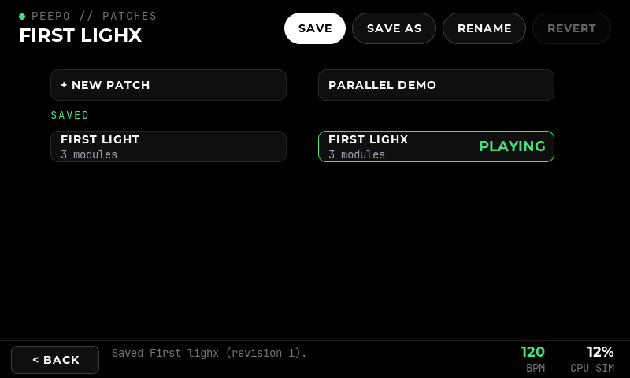
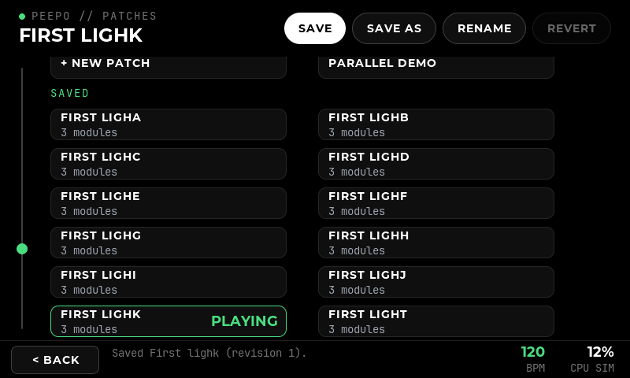
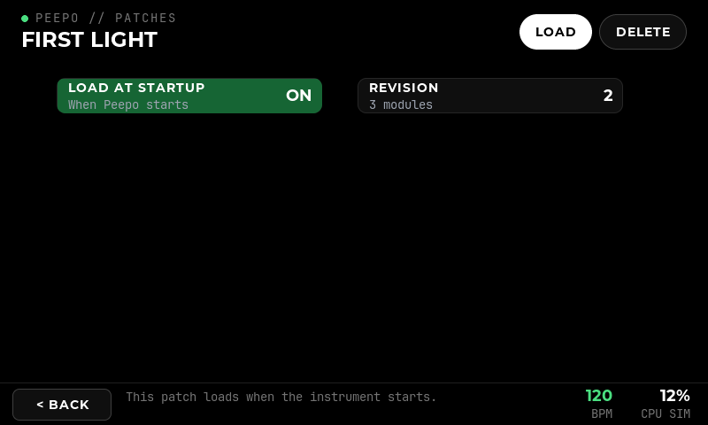
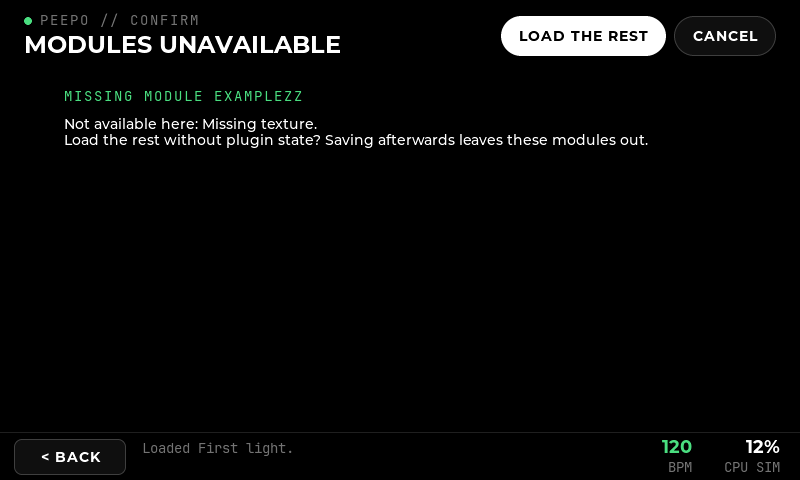

# Patch storage and connection states

**Implemented:** 14 October 2026, on the Windows PC. **Scope:** P4.6 (error and reconnect states) and the PC side of Phase 5 (P5.1–P5.8): patches saved to disk with plugin state, revisions, the patch manager, restore and error handling. **Verified against:** the patched Ingen of [the engine evidence](14-ingen-engine-evidence.md) under WSL2 on JACK's dummy backend, with the LV2 example amplifier, the example `params` plugin (which has LV2 state) and Poly's Mist Granular. Recorded output: [evidence/patch-storage-results.txt](evidence/patch-storage-results.txt). **Original PC record excludes:** Pi hardware, power loss during a save, NAM models and impulse responses as real assets, and the touch screen. The later native Clouds persistence check is recorded below.

## What was verified

**Pi verification, 14 October 2026:** the user's Clouds guitar patch was saved to the Pi card and reloaded through the same adapter and store used by the interface. The graph, eleven controls, positions and stored identity were restored (numeric tolerance 1e-6). Both revisions remain: the original with Freeze on, and a live-input revision with Freeze off. An interface-only restart during guitar playing kept the saved patch unchanged and caused no heard interruption; 8,251 monitored audio blocks had no gaps, xruns or silent outputs. See [the native record](23-pi-bring-up.md#patch-saveload-and-interface-restart-with-guitar) and [raw results](evidence/pi-persistence-results.txt). Clouds has no saved audio-buffer state; this check does not establish persistence of a frozen sound or of file-based plugin assets on the Pi.

| Check | Result |
| --- | --- |
| Save | The engine writes the whole graph as an `.ingen` bundle in about 15 ms (Linux) or 130 ms (Windows to WSL). The interface reads it back, checks its identity and publishes it. |
| Load | A stored patch replaces the engine's graph. Identity, name, modules, cables, values, positions and the Mutable-derived module's controls come back, and a second client follows. The level measured through the reloaded patch is the saved one: 0.25 in, 0.5000 out through the amplifier at +6.02 dB. |
| Plugin state | `params` saves its state into `m4/state.ttl` with the file it names beside it. That state reloads, and also reloads after the bundle is moved to another folder. |
| Revisions | A second save becomes revision 2. Two are kept. An interrupted save leaves the previous revision untouched and is cleared on the next start. A damaged newest revision falls back to the one before, and says so. |
| Unsaved edits | The marker lives in the engine. Both clients see it, and a restarted interface knows which stored patch is playing and whether it has unsaved edits. |
| Refusals | A patch needing a plugin the engine lacks is refused before anything changes. A bundle the engine cannot read is reported as a failure, not as an empty patch. A bundle from a newer schema is not offered. |
| Foreign bundles | A bundle stripped of every project property and position loads in the real engine. It gets default names and layout, keeps its values, and takes the identity of its folder. |
| Windows | The Windows build saves into a Windows folder that the engine in WSL writes through `/mnt/c`, and the same checks pass. |
| Interface | Real LVGL pointer checks cover Save, Save as, Load, Startup, Delete with confirmation, a missing module on load, the reconnecting banner and the startup patch. A restart over an unsaved patch leaves it alone. |
| Connection states | Against the real engine: stopping it shows RECONNECTING with the reason, keeps the last graph and pauses edits. Starting it again brings its graph back by itself. |

Unit tests: `peepo_storage_tests` (bundles, revisions, recovery, foreign bundles, missing files, the simulator), `peepo_ingen_tests` (save and load against the stand-in engine, which now loads files as the real one does), `peepo_ui_check`. All six Windows CTest suites pass.

## What the engine does

Recorded with `tools/ingen-spike/10-bundle-probe.sh` against the live engine. Each point decided part of the design.

1. **Format.** `patch:Copy` from `ingen:/main` to `file:///…/name.ingen` writes a directory: `main.ttl` (the graph), `manifest.ttl`, `plugins.ttl`, and a subdirectory per stateful block (`m4/state.ttl`, plus any file the state names). `main.ttl` uses references relative to the bundle (`<m3>`, `<m3/gain>`, `<>` for the graph). Project properties on blocks, ports and the graph are written and restored, as P5.1 assumed.
2. **Load into a running engine.** `patch:Copy` from the bundle to `ingen:/main` adds its contents to the root graph. The reply comes **before** the loaded graph is announced. The adapter therefore asks for the graph again only after the reply; that request is queued behind the loaded content, so its answer is the loaded patch.
3. **The reply proves nothing.** A bundle that does not exist, or cannot be parsed, is answered with success and loads nothing. The adapter compares what it expected with what the engine then holds. If nothing arrived the load fails, with a message pointing at the folder mapping.
4. **One missing plugin, and nothing loads.** If any block's plugin is not installed, the engine builds none of the bundle. The adapter refuses such a load up front. The interface can instead offer the rest, rebuilt from the bundle's description without plugin state, and says so.
5. **Graph properties outlive blocks.** Deleting every block leaves the graph's name and identity in place. A load clears both first, so a bundle without them, or one that fails, cannot leave the emptied graph claiming the previous patch.
6. **Escaped paths.** A `file://` URI with `%20` is decoded for some files and not others, producing two directories. Patch folders are restricted to letters, digits, `.`, `_` and `-`.
7. **A client that stops reading stalls the engine.** The engine writes to each client with many small blocking sends. A client that connects and never reads fills its socket buffer after a few hundred of them; the engine's main thread then blocks, and no client gets answers. The adapter reads continuously on its own thread, so it is never that client. Any future client (a control daemon, a debugging tool) must do the same. Audio was not observed to stop, but this is not a measured claim.
8. **TCP after a kill.** An engine started immediately after another was killed can fail to open its TCP port (`Failed to create TCP socket`) while the Unix socket works. A few seconds' pause avoids it. The Pi uses the Unix socket.

## Storage contract (P5.1, P5.5)

```
<root>/<id>/r000007.ingen/            newest complete revision
<root>/<id>/r000006.ingen/            the one before, kept as a fallback
<root>/<id>/.staging-r000008.ingen/   being written; never read as a patch
<root>/startup                        identity of the startup patch
```

- **Identity.** `p` + UTC date and time + 4 random hex digits, for example `p20261014-111902-0d64`: lowercase letters, digits and hyphens. It never changes; the display name is a property and can.
- **One bundle per revision**, written by the engine itself, so plugin state is the host's own.
- **Complete saves.** The engine writes into staging. Only after it has answered, and `main.ttl` reads back with the right identity, is the directory renamed to its revision name. A rename to a new name is atomic on Linux and Windows. The previous revision stays until the new one exists, and revisions beyond two are then removed.
- **Recovery.** Opening the store removes staging directories and unfinished deletions. A patch whose newest revision is unreadable offers the previous one, with the reason; with none readable it is listed but cannot be loaded.
- **Deletion** renames the patch out of the list in one step, then removes it, and clears the startup choice if it pointed there.
- **Startup choice** is written to a temporary file and renamed over `startup`.

## Property schema (P5.3)

| Property | On | Meaning |
| --- | --- | --- |
| `peepo:patchId` | graph | Stored identity; empty for a patch never saved |
| `peepo:patchName` | graph | Display name |
| `peepo:schemaVersion` | graph | `1`. A bundle with a higher number is not offered; a missing one is read as a pre-schema bundle |
| `peepo:modified` | graph | Unsaved edits since the last save or load |
| `peepo:displayName` | block | Module name |
| `ingen:canvasX`, `ingen:canvasY` | block | Position (Ingen's own) |
| `peepo:control-<control>` | graph | One per pinned physical control (`control-enc1`, `control-stomp2`); see [physical controls](18-physical-controls.md). An empty value is an unpinned control |

Graph properties are set with `patch:context ingen:internalContext`, without which the engine does not keep them. Every property is optional on reading. Without a name a module takes its catalogue name, a block without a position is laid out in a row, a graph without a name is "Untitled", and a bundle without an identity takes its folder's.

## Assets (P5.4)

- **Plugin state is the engine's.** LV2 state is saved and restored by Ingen through the host's state interface; nothing rewrites its paths.
- **Files kept with the bundle** are named relative to their state file (`<params.ttl>`). They travel with the bundle, which the relocation check confirms.
- **Referenced files** are absolute (`file:///…`). Models, impulse responses and samples are to live under one asset folder beside the patches (`<data>/assets/models`, `irs`, `samples`). Patches refer to them there rather than importing copies; this is a decision for Phase 8, not yet exercised by a real model.
- **Missing-file detection.** When a patch is listed or loaded, every file named by its saved state is checked. Relative files are always checked; absolute ones only when the engine shares this filesystem under the same names, since on Windows the engine's paths are not this program's. Missing files are shown on the patch and named after loading.

## Engine contract changes

- `SaveGraph{Persistent, include_plugin_state, location, patch_id}` writes the bundle and gives the graph its identity. The unsaved marker is cleared only after the engine's answer. A refused save puts the previous identity back.
- `LoadPatch{location, blocks, patch_id}` replaces the graph with a bundle, as described under [What the engine does](#what-the-engine-does).
- `Graph::patch_id` carries the stored identity, and `Graph::dirty` is now the engine's marker.
- Capabilities: the Ingen adapter reports persistent save and plugin state. The simulator reports persistent save without plugin state; it writes `main.ttl` and `manifest.ttl` in the same layout, so the patch manager works without an engine.

## Interface

**Patches** is built like a module page (21 October 2026). The title is the patch playing, with `*` for unsaved edits, and the header pills act on it:

- **Save** (white) writes a new revision of the playing patch, or creates one the first time.
- **Save as** asks for a name and saves a separate copy.
- **Rename** is stored with the next save, and identities do not change.
- **Revert** and **MIDI**: see [screens](28-screens-and-diagnostics.md) and [MIDI](39-midi.md).

Below, one list, two bars to a row, that scrolls with the rail on the left as a module page does; there are no pages. **+ New patch** comes first (and **Parallel demo** in the simulator). Under **SAVED**, each stored patch is a compact bar: its name, its module count or what is wrong with it, and **PLAYING** or **STARTUP** on the right. The playing patch has a green edge.

Tapping a patch opens its actions, like a module's: **Load** (white), **Load at startup** (green once it does; tap again to stop) and **Delete patch**, with its revision and any issue below. For the patch playing, Load reads **Load saved** and is only offered with unsaved edits. Back returns to the same place in the list.

- Loading over unsaved edits asks first, as does Delete.
- A patch with an unavailable module asks whether to load the rest without plugin state.

**Startup.** When the interface starts, it loads the startup patch only if the engine plays no stored patch and has no unsaved edits. A restarted interface therefore never replaces what is being played. It also offers the startup patch again when a fresh, empty engine appears after a restart.

**Connection states (P4.6).** The header shows STARTING, READY, RECONNECTING, OFFLINE or ENGINE ERROR. On the patch page a banner gives the reason and says that edits are paused and the last graph is shown. **+ Add** is disabled meanwhile, and the footer says when the engine is back.

A failed add names the module and the engine's reason. Settings shows the connection state with Connect and Disconnect, and where patches are stored. Disconnecting stops only the interface; nothing in it starts or stops an engine.

**Windows.** `--patches DIR` chooses the folder; the default is `%LOCALAPPDATA%\Peepo\patches`, or `simulator-patches` for the simulation. With `--engine`, the engine is told the same folder as WSL sees it (`/mnt/c/…`), unless `--engine-patches PATH` says otherwise.







## Limits and open points

- **Power loss** during a save is not tested, and nothing calls `fsync`. A rename is atomic, but the files it publishes may not yet be on the card. Decide this with Phase 10's storage choice (P10.5).
- **Load the rest** rebuilds modules, values, cables and layout, but not the plugin state of the modules it keeps, because the engine cannot load part of a bundle.
- **Asset folder** is defined but no real model, impulse response or sample has been saved yet; that comes with Phase 8.
- **The startup patch** is loaded by the interface. Loading it before the interface exists, at boot, is Phase 10 (P10.4).
- **Another client's edits** set the unsaved marker only if that client sets it too; the adapter does.
- **Font.** Montserrat in this build lacks accented letters, so a name such as "é" shows a box.
