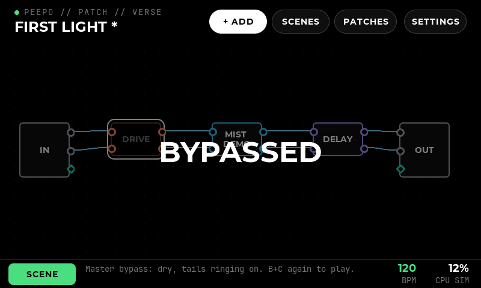
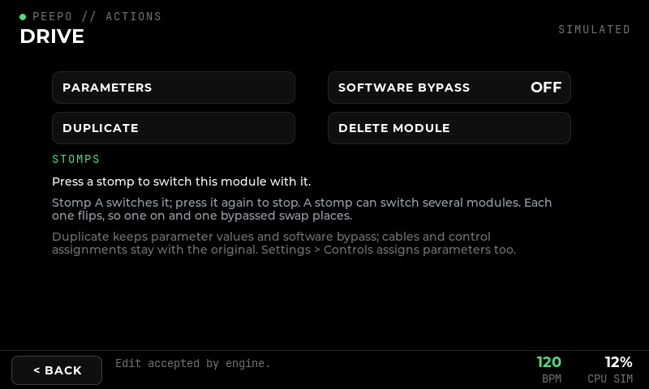
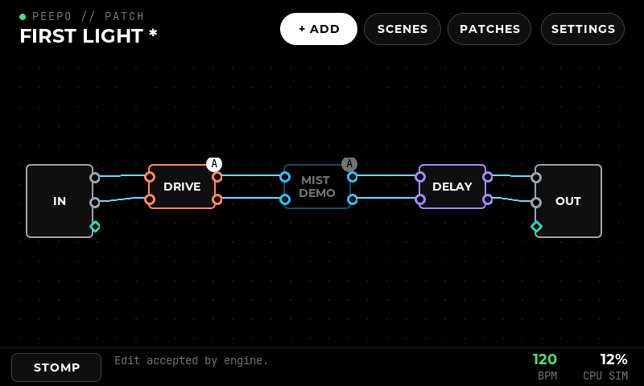
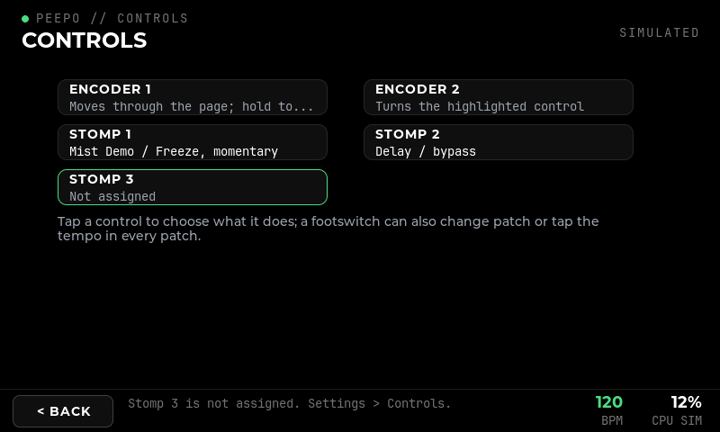
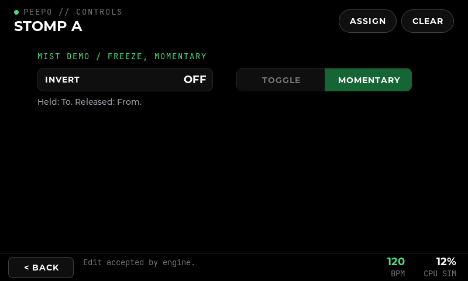

# Physical controls

**Changed 17 October 2026:** two encoders instead of four, with a new encoder model; see [module page and two encoders](31-module-page-and-two-encoders.md).

**Changed 28 October 2026:** **four stomps instead of three**, the layout of many commercial floor units. The two-stomp switches D (A+B) and E (B+C) are replaced by three chords with fixed meanings: B+C is master bypass, A+B and C+D change bank in scene mode and are assignable in stomp mode, and holding C+D starts tap mode ([below](#four-stomps-and-their-chords-28-october-2026)). The sections below are updated.

**Implemented:** 14 October 2026, on the Windows PC, without the hardware. **Scope:** P7.2 (simulated controls), P7.4 (mapping rules), P7.5 (assignment screen and storage), the patch-independent part of P7.6, and a wiring and transport proposal for P7.1. **Verified with:** unit tests, real LVGL pointer checks, the simulator, and against the patched Ingen under WSL, where assignments are saved and reloaded. **Not covered:** the encoders and switches themselves, the GPIO driver (P7.3), tap tempo and the resilience checks of P7.7.

## The hardware

The user owns **four 20-pulse rotary encoders with push switches** and can get **momentary SPST footswitches**. Beebo uses two encoders and three stomps. Peepo first planned four encoders and three stomps (D11); since 17 October 2026 it uses two encoders, and since 28 October 2026 **two encoders and four stomps**.

**Momentary SPST footswitches are the right choice.** A momentary switch tells the instrument only "pressed" and "released"; what that means is decided in software, per patch:

- **Toggle:** each press flips a parameter or a module's bypass.
- **Momentary:** a value is held only while the foot is down.
- **Patch changes and, later, tap tempo:** each press is one event.

A **latching** switch would be wrong here. Its physical position would disagree with the patch as soon as the patch changes, or the same effect is switched on the screen; it can also do nothing useful for momentary, tap or hold actions. Prefer "soft-touch" momentary types if quiet operation on stage matters. Both kinds work electrically.

Two encoders suit the module page, which shows a dozen controls at once: one moves between them, the other turns the one highlighted.

## Wiring proposal (P7.1 — proposed, to verify on the Pi)

Everything connects directly to the Pi 5's header, with no extra board: the screen uses HDMI and USB, so the GPIO header is free. Each encoder needs three GPIOs (A, B, push) and each stomp one, **10 GPIOs** in total, all switching to ground with the Pi's internal pull-ups.

| Control | A | B | Push / switch |
| --- | --- | --- | --- |
| Encoder 1 | GPIO 5 | GPIO 6 | GPIO 12 |
| Encoder 2 | GPIO 13 | GPIO 16 | GPIO 17 |
| Stomp A–D | GPIO 4, GPIO 7, GPIO 8, GPIO 22 | | |

GPIO 23–27, which the third and fourth encoders had, are free. Stomp D sends KEY_F20 (`config/pi/config.txt`, `config/pi/controls.conf`).

- **Pins left free.** I²C (GPIO 2/3, which have fixed pull-ups), the UART (14/15) and I²S (18–21) stay free, in case an audio HAT or a serial console is wanted. Stomps 2 and 3 use SPI0's chip selects, which nothing here needs.
- **Encoders.** The common pin and one push-switch leg go to ground.
- **Stomps.** One terminal to the GPIO, the other to ground. Long footswitch leads benefit from twisted pairs and a 100 nF capacitor across the switch; software also ignores bounces (below).

**Transport (proposed):** the kernel's own drivers, enabled in `config.txt`:

- `rotary-encoder` overlays turn each encoder into relative-axis input events;
- `gpio-key` overlays turn each push and stomp into key events.

The kernel decodes the quadrature (and so ignores contact bounce on A/B). Each encoder is given its own relative axis and each push or stomp its own key code, so the interface recognizes them by the codes they report, whatever the device numbering (`config/pi/controls.conf`). A 20-pulse encoder with 20 detents gives one full quadrature cycle per detent; whether the overlay reports one step per detent must be checked on the bench. If the overlays prove unsuitable on the Pi 5, the fallback is reading the pins directly with libgpiod. The adapter that reads these devices (P7.3) now exists and is tested with virtual devices ([Linux and Pi](19-linux-and-pi.md)); what remains is checking it against the real parts.

## How the controls behave

Every source — the simulator's keys today, the GPIO adapter later — produces the same raw events: **Turn** (detents, clockwise positive), **Press** and **Release**. `ControlRecognizer` turns them into gestures; the interface applies them. Nothing else depends on where the events come from.

**Encoders** (17 October 2026)

- **Encoder 1 moves.** On a module page it moves a white highlight from bar to bar; on the patch it highlights a module, left to right; in the browser it steps through the cards; elsewhere it steps through the page's buttons.
- **Its push acts** on what is highlighted: opens a module, flips a switch, steps a mode, opens the file list, presses a button, adds a card.
- **Holding encoder 1** (0.7 s without turning) goes **Back**.
- **Encoder 2 turns** the highlighted value on a module page, steps through the groups in the browser and the header buttons on the patch. Its push flips a switch or steps a mode.
- **Push and turn** is fine adjustment.
- **One encoder alone** works too: pushing encoder 1 on a value makes it turn that value (the highlight takes the module's colour); another push goes back to moving.
- **Pinned** in Settings → Controls, an encoder turns its target on every page instead. Its tap opens that target's page with the control highlighted; its hold unpins it. The bar shows "E2" under its name.

**Stomps** act on the press itself, never waiting for a gesture to end:

- **Toggle:** each press switches between the ends of the assigned range (off/on for a switch such as Clouds freeze).
- **Momentary:** the far end while held, the near end on release.
- **Bypass:** each press switches the software bypass of one module or several (16 October 2026). Each module flips: one playing is bypassed, one bypassed plays. So two modules set opposite ways swap places, as Beebo's manual suggests for switching between two delays.
- **Foot switch modules:** a Foot switch module in the patch listens to one stomp (below) and hears every press and release, beside whatever the stomp is assigned.
- **Next or previous patch, tap tempo:** instrument-wide (below).
- A press closer than 25 ms after a release is a bounce and is ignored.
- **Chords:** two neighbouring stomps pressed together (below). A stomp acts 40 ms after it is pressed, unless its neighbour joins it in that time. In a patch in scene mode the stomps play scenes instead ([scenes](44-scenes.md#on-the-screen-stomps-and-midi)).

### Four stomps and their chords (28 October 2026)

The stomps are **A, B, C and D**, left to right. Two neighbours pressed together are a **chord**: A+B, B+C and C+D. A and C, or B and D, are two stomps.

| Gesture | Stomp mode | Scene mode |
| --- | --- | --- |
| A, B, C, D | As assigned | Scenes 1–4 of the bank shown |
| A+B | As assigned | Bank 1 (scenes 1–4) |
| C+D | As assigned | Bank 2 (scenes 5–8) |
| B+C | **Master bypass**, in every patch and on every page | |
| A+B held 1 s | Stomp mode or scene mode, as the pill at the bottom left of the patch | |
| C+D held 1 s | **Tap mode** | |

- **Recognized** by `ControlRecognizer` (`src/controls`). A chord says Press as soon as both are down, Hold once held `chord_hold_ms` (1 s), and Tap when let go if it was not held, then Release. The first of the two released ends it; the other's release says nothing. The chords are `stomp12`, `stomp23` and `stomp34`, named A+B, B+C and C+D on the screen.
- **A+B and C+D act when let go**, so holding them is never also a press. Their press and release are played together, so they take toggle, bypass, next or previous patch, tap tempo and Loo-pi commands, but **not momentary**: Settings → Controls offers no Toggle / Momentary choice for them. They are saved as `peepo:control-stomp12` and `-stomp34`.
- **Master bypass (B+C)** acts on the press. Every module playing is bypassed at once, in one engine bundle (`SetBypasses`), so delays and reverbs ring on as for a scene change (spill bypass, or the plugin's own switch); Loo-pi, being bypassed, mutes its loops. B+C again plays exactly the modules it bypassed, those still bypassed. It is a performance change: the patch is not marked edited and no scene is written. So it is never mistaken for a patch playing, a large **BYPASSED** lies over the patch page, the patch dimmed beneath it but still in sight and still answering touches (the 48 px font now holds P, S and Y). Each module is drawn as it will play when master bypass ends, not as bypassed, so the player sees what engaging will sound like.

   Another patch or another scene played ends it, the new one playing as saved. Save is refused while it is on, as every module would be stored bypassed. It cannot be assigned; Settings → Controls shows it as "Master bypass (every patch)".
- **Tap mode (C+D held)**: every stomp taps the patch tempo, at once, without waiting for a chord, and does nothing else. It ends 3 s after the last tap (or after starting with none), saying the tempo. The BPM caption at the bottom right reads TAP meanwhile. A stomp can still be set to Tap tempo in every patch, as before.
- **A tuner on B+C held** was discussed. It is not built: Peepo's tuner is a module in a patch, so a tuner the stomps can always reach needs one outside the patch first.
- **Patches from before.** `stomp4` used to be D (A+B) and is now the physical stomp D, so a patch that assigned D now has that on stomp D. `stomp5` (E) is no longer a control; its assignment is kept in the patch and never applied.

**Assigning a stomp from the patch (16 October 2026).** Beebo's way: hold a module on the patch, and its actions open. A stomp pressed while they are open does not play. It now switches that module's bypass, beside any others it already switches; pressing it again there takes the module off. The page says which stomps switch the module. On the patch, each module a stomp acts on shows the stomp's number in a white dot on its top right corner: through its bypass, through an assigned parameter, or, for a Foot switch module, the stomp it listens to.

**A stomp as a control signal (16 October 2026).** The **Foot switch** module (CV + UTIL) is Peepo's own plugin (`plugins/footswitch.lv2`, `urn:peepo:lv2:footswitch`), standing in for Beebo's Foot Switch A-E modules, whose plugin has no public source. Its control output can be cabled to any control input, for example through a slew limiter to a delay's feedback.

- **Stomp** (A to D): the stomp it listens to. Not a chord.
- **Latching:** off, the output follows the stomp (On value while it is down); on, each press flips it.
- **On value** and **Off value** (0 to 1): what the output gives in each state.
- **Pressed:** the state the interface sets from the stomp. It can also be switched on its page.

A stomp a Foot switch module listens to belongs to the patch, like an assigned one: it does not also take its every-patch action. Beebo's Foot Switch modules also have a tap tempo output. Peepo's has none, because control cables connect control (CV) ports only, while a module's BPM is a plain control. A stomp set to **Tap tempo** sets the patch tempo instead, and every module with a BPM control follows that.

Switch actions go to the engine at once; only encoder turns are coalesced (one value in flight, newest wins), so a stomp is never delayed behind a stream of knob movement. Controls are ignored while a name is being typed.

## Mapping rules (P7.4)

| Kind | One detent | Notes |
| --- | --- | --- |
| Continuous | 2 % of the range (fine: 0.2 %) | In the parameter's own scale, so a logarithmic frequency moves by even ratios |
| Acceleration | ×2 under 100 ms between detents, ×3 under 50 ms, ×5 under 25 ms | Bounded; never when fine; 20 detents per turn means about 2½ turns end to end, under one when spun |
| Integer | ±1 | Accelerates only when the range spans more than 24 values |
| Choice | ±1 | Stops at the ends, never wraps |
| Switch | Clockwise on, anticlockwise off | |

- **Range and inversion.** An assignment may narrow the range (From/To) and invert the direction. A value outside the narrowed range comes into it on the first detent.
- **No jumps.** Encoders are relative, so a patch change can never make a value jump.
- **Absolute controls.** For potentiometers or an expression pedal, if ever added, `Pickup` implements soft takeover: the control takes effect only once it reaches or crosses the current value.

## Assignments (P7.5)

**Settings → Controls** lists the two encoders, the stomps A to D and the chords A+B, B+C and C+D. Each row shows its assignment, an orphan in orange, or what the encoder does unpinned / "Not assigned". Using a control highlights its row, which is how to find which physical knob is which.

- **Assign** picks a module, then a parameter. Stomps also offer **Bypass**, and **Next patch** / **Previous patch**. A bypass joins the modules the stomp already switches; a parameter replaces whatever the stomp did. **Clear** empties it.
- **Edit** sets Invert, Toggle or Momentary, the From and To ends of the range, or clears it.

**Storage.**

- **Per-patch assignments** are graph properties, one per control: `peepo:control-enc1 "parameter|m4|<plugin>|mix|0|100|0|toggle"`. They therefore live in the engine and in the saved bundle, like everything else (D13), and survive an interface restart. A stomp switching several modules holds one such value per module, separated by spaces (no field can hold one): `peepo:control-stomp1 "bypass|m3|<plugin>|... bypass|m5|<plugin>|..."`. A control holds either one assignment or bypasses only.
- **The plugin is recorded.** A different module that later holds the same identity is never controlled; the assignment is shown as orphaned and is never applied.
- **Removing a module** removes its assignments in the same edit; a stomp keeps the other modules it switches. Duplicating one does not copy them.
- **Patch changes are instrument-wide.** A footswitch that changes patch must do so in every patch, so those actions are kept beside the patches (`<patches>/controls`), not in one. A patch's own assignment of the same stomp takes precedence while it plays.
- **Unsaved edits are guarded.** A patch change from the footswitch asks first if the current patch has unsaved edits, exactly as on screen.

## Trying it in the simulator

| Keys | Control |
| --- | --- |
| Q / A, W / S | Turn encoders 1 and 2 clockwise / anticlockwise (holding a key repeats, which shows acceleration) |
| 1, 2 | Push encoders 1 and 2 |
| Z, X, C, V | Stomps A–D |
| B, N, M | A+B, B+C and C+D, both stomps pressed at once (hold the key for a held chord) |

The keys work in the Windows build against the simulation or a real engine. They still reach LVGL, where they are text on the name page; the interface ignores them as controls there.

## Verification

- `peepo_controls_tests`: gestures (tap, hold, fine, bounce, repeated presses) and every mapping rule above. It also covers soft takeover, encoding, validation of assignments and orphans, and assignments in the simulator: replaced per control, removed with their module, saved and loaded through the patch store. The instrument-wide actions are covered too.
- `peepo_ingen_tests`: assignments as engine graph properties, seen by a second client, kept across an interface restart, cleared by a new patch, saved, loaded and removed with their module.
- `peepo_ingen_live` against the real engine: an inverted encoder pinned to Mist Granular's first control is saved and comes back from disk.
- `peepo_ui_check`, through the same entry point the hardware will use:
  - (17 October 2026) encoder 1 moving the highlight over Drive's bars and encoder 2 turning them, fine steps, one-encoder turning, hold for Back, a pinned encoder working from the patch page, tap to show and hold to unpin; encoder 1's push flipping Clouds' Freeze; encoder 2 reaching Settings from the patch;
  - the Controls page assigning stomp 1 to Clouds freeze in toggle and then momentary mode, and stomp 2 to Delay's bypass;
  - an unassigned stomp, controls ignored while typing a name, a removed module taking its assignment along, and a next-patch footswitch stepping through stored patches and wrapping.
  - (16 October 2026) holding Drive and pressing stomp 1 assigns its bypass without playing; Clouds joins the same stomp; the patch numbers both; with Clouds bypassed each press swaps the two; Controls names both; pressing again on Drive's actions takes it off. A Foot switch module set to stomp 2 is pressed and released with it, ignores stomp 3, and when latching flips on each press.
- `peepo_core_tests`, `peepo_ingen_tests`, `peepo_storage_tests` (16 October 2026): a stomp switching two modules is valid, the same module twice or a parameter beside bypasses is not; adding, unassigning one module and removing a module through the simulator and the adapter; one engine property holding both, seen by a second client; a bundle round trip.
- `tools/ingen-spike/19-delay-footswitch.sh` in the engine under WSL: the Foot switch's control output gives Off value, then On value once Pressed is set.

## Open points

- **P7.3:** the adapter that reads the kernel's input devices exists and is tested with virtual devices; the overlays, bindings and boot lines are in `config/pi/` ([Linux and Pi](19-linux-and-pi.md)). Still to check on the real parts: the overlays themselves, the steps per detent and switch bounce.
- **P7.6:** tap tempo works from a stomp set to it and from tap mode (C+D held). A second action on a held single stomp is not defined.
- **P7.7:** unplug/reconnect does not apply to wired GPIO controls; a UI restart, patch reload and rapid gestures should be repeated on the Pi.
- **While the interface is down** the controls do nothing: they are read by the interface. Controls that keep working through an interface restart would need a separate control daemon, which the engine supports as a second client.
