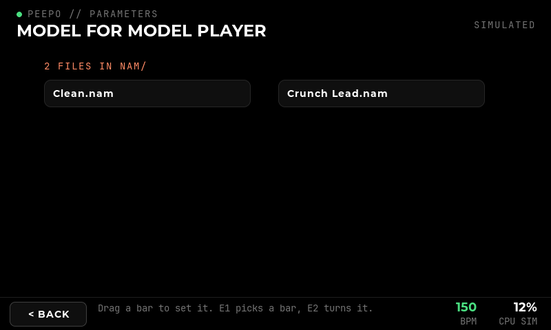
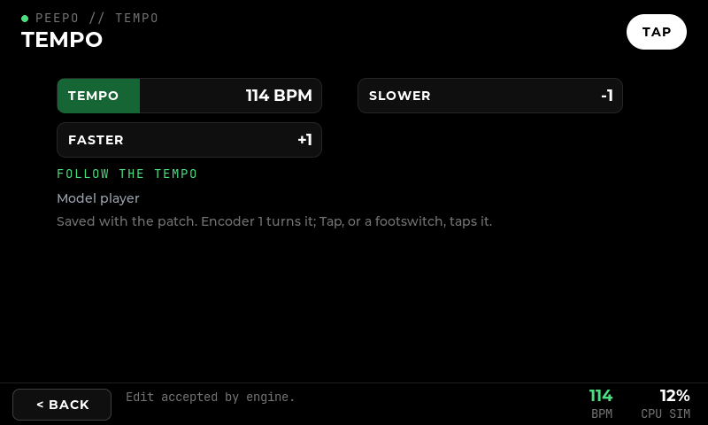

# Parameter pages, model and IR files, patch tempo

**Implemented:** 16 October 2026. **Scope:** P9.4 (per-module grouping and value editors), P8.3 (NAM and cabinet pages: model and IR selectors, active file, input/output and quality), patch tempo (the BPM reading in every footer, tap tempo of P7.6). **Verified with:** real LVGL pointer checks on Windows, the adapter against the stand-in engine, catalogue and storage tests, the arm64 suite, and on the Pi (see [Results on the Pi](#results-on-the-pi)). **Not covered:** review on the physical screen, listening, and CPU cost of NAM and IRs (P8.4 onwards).

## Parameter pages (P9.4)

**Superseded 17 October 2026:** groups are now headings on a single page of bars, modes step on a tap, whole numbers and beats step with encoder 2, and the file is the first bar ([module page and two encoders](31-module-page-and-two-encoders.md)). The images here show the new page.

The catalogue overlay can now arrange a module's controls in **named groups** of up to four, one per page. The page shows the group's name above the page count, in the module's colour; controls no group names follow on pages called More. A group may name the general Output. A rule matching several plugins (all the Clouds modes) leaves out what one of them lacks; a rule for one plugin must name only its shown controls.

Grouped so far:

| Module | Pages |
| --- | --- |
| Clouds, all modes | Main, Pitch and mix, Space |
| Rotary speaker (full), 36 controls | Speed and level, Horn motor, Horn filter 1, Horn filter 2, Drum motor, Drum filter, Brakes, Cabinet, Microphones, More |
| Parametric EQ, mono and stereo | Band 1 to 4, Low shelf, High shelf, High-pass, Low-pass, More (Output) |
| Vinyl | Record, Sound 1 to 7, Levels |
| MultiBand | Split, Compression, Band levels, Timing, More |
| Marbles | T clock, T randomness, X voltages, X modes, Y voltages, More |

Per control, the overlay can also mark a **logarithmic** scale and **name the values** of a whole-number control that counts from 0, which then shows as a list of choices. The Rotary speaker's filter frequencies and Vinyl's input and output gains (linear factors from 1/64 to 64) are now logarithmic; the EQ's peak-hold reset, which belongs to a meter Peepo does not draw, is hidden. No numeric modes are named yet: names are added only where the plugin's meaning is known.

Value editors:

- **A list of two to four modes** whose names fit is a row of buttons, the chosen one marked in the module's colour: one tap instead of opening a menu. Longer lists keep the drop-down.
- **Whole numbers** have **-** and **+** beside a shorter slider, each a step, disabled at the ends.

## Model and IR files (P8.3)

**19 October curation:** new patches use Poly's **Cabinet** and **IR Reverb**
families, each with Mono, Mono to Stereo and Stereo entries. The alternate
LV2 Convolution and x42 IR Convolver entries are hidden for older patches.
The historical implementation table below includes those legacy identities.
Cabinet uses the short-IR configuration; IR Reverb uses the longer-IR configuration.
The stereo variant accepts mono or stereo IRs for independent left/right
processing. Four-channel IRs add the cross-channel paths, ordered LL, LR, RL, RR.
The two built-in cabinet simulators remain explicitly labelled as built-in
and do not need IR files. See [catalogue purge](36-catalogue-purge.md).

A plugin's file is an LV2 `patch:writable` parameter with an `atom:Path` range. The overlay names it for each module (`"file": {"property", "label", "folder", "extensions"}`):

| Module | Property | Folder |
| --- | --- | --- |
| NAM | `neural-amp-modeler-lv2#model` | `nam/`, `.nam` |
| Cabinet (Poly convolver, Cab variants) | `polyconvo#ir` | `ir/cab/`, `.wav`, `.flac` |
| IR reverb (Poly convolver) | `polyconvo#ir` | `ir/reverb/` |
| LV2 Convolution | `convoLV2#impulse` | `ir/reverb/` |
| x42 IR Convolver (withheld) | `zeroconvolv#ir` | `ir/reverb/` |

On its page the file is the first tile: its label (MODEL, CABINET, IMPULSE RESPONSE), the chosen file's name, or "None chosen", and Choose or Change. NAM's page then shows Input, Output and Quality.

**Choose** lists the files of that folder with those extensions, eight to a page, by name, the current one marked. With none, it says which folder to copy them into. Files are copied by hand (for example over SSH); the interface only lists them. On the Pi the folder is `/var/lib/peepo/files` (`--files`), with `nam/`, `ir/cab/` and `ir/reverb/` made at start; on Windows it is beside the patches, and the engine in WSL sees it through `/mnt/<drive>`.

Choosing sends `SetFile`. The adapter:

1. sends the plugin a `patch:Set` of that property with the path as an `atom:Path`, on its atom control input, the form checked in P8.2;
2. sets `peepo:file` on the block, so every client, a restarted interface and the saved patch name the file.

The plugin loads the file in the background and keeps it in its own state; Ingen copies it into the bundle when the patch is saved. A duplicate is given the file again (Ingen copies a block's values, not its file). Paths must be absolute, without `..`; spaces are fine. A file that fails to load leaves the plugin running without it (P8.2), and the tile still names what was chosen.

NAM, LV2 Convolution and Poly's convolvers (IR reverb, Cabinet) were withheld only because no file could be chosen, and are offered again. The **x42 IR Convolver** stays withheld: on the Pi its worker fails when given an impulse response ("Error calling /m3 work method", after "No nominal block-size given"), so it never plays one. It probably needs an engine option Ingen does not offer; not investigated further.

## Patch tempo

Every patch has a tempo, 30 to 300 BPM, 120 by default. It is a graph property (`peepo:tempo`), so it is in the engine, seen by every client and saved with the patch; a bundle saved before it existed plays at 120.

Modules take the tempo the way Beebo's modules do, on a BPM control of their own. The overlay names that control (`"tempo": "BPM_1"`) for Beebo's Delay, Poly's chorus, flanger, harmonic tremolo, vibrato, BPM sequencers, Grids, trigger-to-gate and tempo ratio, and AMS's beat repeaters, beat slicers and tempo LFO (Beebo's LFO). Changing the tempo sets every such control in the patch, inside its own range; a module added later starts at the patch tempo. The control stays on the module's page: moved by hand, it leaves the tempo until the tempo next changes. Plugins that read JACK transport instead (a few MOD and x42 plugins) do not follow it; that needs the engine to act as a JACK timebase master, which it does not.

The footer's **BPM** is now the patch tempo (no longer a simulator fixture) and opens the **Tempo** page: the tempo, -5, -1, +1, +5, a slider, a large **Tap** pad, and the modules that follow it. On that page an unpinned encoder 1 turns the tempo by one BPM a detent. A footswitch can be set to **Tap tempo** in Settings > Controls; like next/previous patch it works in every patch that does not use the switch otherwise. Taps: two give a tempo, up to four intervals are averaged, a pause longer than two seconds starts again, and the result is shown and stored in whole BPM.

**Times in beats (16 October 2026).** Beebo's Delay (`http://polyeffects.com/lv2/digit_delay`, now built from Poly's archived Digit source) sets its time in beats at its own BPM, and its BPM follows the patch tempo. Rhythmic delays come for free: 1/8 is 250 ms at 120 BPM and 500 ms at 60. The overlay gives such a control the unit `beats`. Its tile then shows the note it lasts (1/32 up to 4 bars, with dotted and triplet values) and the same time in milliseconds at the module's tempo. **-** and **+** step from one note value to the next, as does an encoder; pushed and turned, the encoder moves freely, and so does the slider. Between two notes the value shows in beats ("0.60 beats").

Beebo's Delay also has a milliseconds mode, which leaves the tempo alone. Peepo has none: a time in beats always follows the patch tempo, and its milliseconds are shown.

## Verification

- `peepo_ui_check`: a grouped module (named first page, More page, encoder push wrapping); mode buttons and -/+ steps; the generic Delay's modes as buttons; the Tempo page from the footer, its steps, Tap pad, encoder 1, a tap-tempo footswitch and a following module; an empty file folder explained, models listed, one chosen and named on its tile.
- `peepo_catalogue_tests`: groups kept, limited to four, a hidden or twice-listed control refused, a matching rule skipping a missing control; named values and logarithmic scales; the grouped modules, tempo controls and file parameters of the real catalogue.
- `peepo_ingen_tests`: tempo stored on the graph, refused out of range without reaching the engine, given to an added and an existing follower inside its range; a file named on the block, refused when relative, with `..`, or on a module without a file; both seen by a second client; the duplicate given the file.
- `peepo_controls_tests`: tap tempo; `peepo_storage_tests`: tempo and file through a bundle, an old bundle at 120, the file store's listing.

## Results on the Pi

The package `peepo-arm64-20261016-b2c1032-dirty` passed all 10 arm64 suites and was installed with `install.sh`; only `peepo-ui` was restarted, and JACK and the engine kept their processes. The Pi's catalogue still exports 226 entries.

`tools/pi/check-engine.sh files` then ran on a second engine beside the instrument, through the interface's own adapter (`peepo_file_live`), with an A1 NAM capture and a 48 kHz cabinet IR. For NAM, LV2 Convolution and Poly's cabinet convolver: the file reaches the plugin and changes the sound of a noise test signal (NAM by 7.2 dB with a reshaped spectrum, the convolvers from silence to sound); a second client sees the file; a relative path is refused; the patch saved with plugin state names the file, reports no missing file, and reloads sounding the same; a duplicate sounds the same. 110 checks passed. The instrument kept its processes; its JACK logged 7 xruns during the run, while the second engine convolved beside it. [Results](evidence/pi-files-results.txt).

Two faults were found and fixed on the way:

- **Saved files with spaces read as missing.** The engine writes a file kept with the bundle as `<A1%20standard.nam>`; the patch store looked for the escaped name, so such a patch was listed with a missing file. It now undoes the escapes.
- The check tool kept a pointer into a temporary graph; fixed in the tool.

The user's own files were copied to `/var/lib/peepo/files` (8 Vox AC15 captures in `nam/`, 10 cabinets in `ir/cab/`, an empty `ir/reverb/`; all 48 kHz), and the same check passed with "Vox AC15CH Crunch Normal" and "TF ORANGE 4X12 V30 57 3": the model changed the sound by 6.5 dB, and the cabinet loaded in both convolvers.

Not checked: the physical screen, listening with a guitar, and CPU cost.

After `systemctl restart peepo-ui` the new interface connected after about 8 s, while after a crash it connects in 1.7 s (re-checked with this package); the engine takes a while to let go of a client that closes in order. Audio is not affected.
