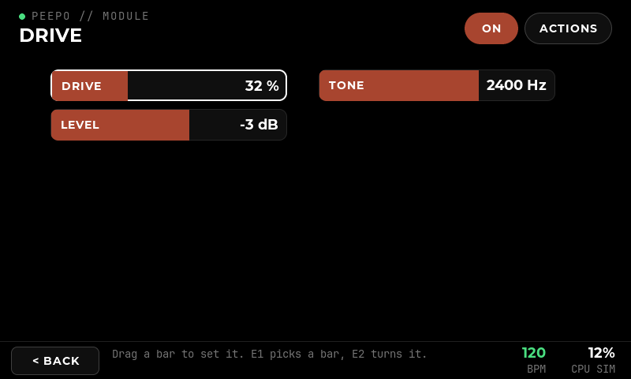
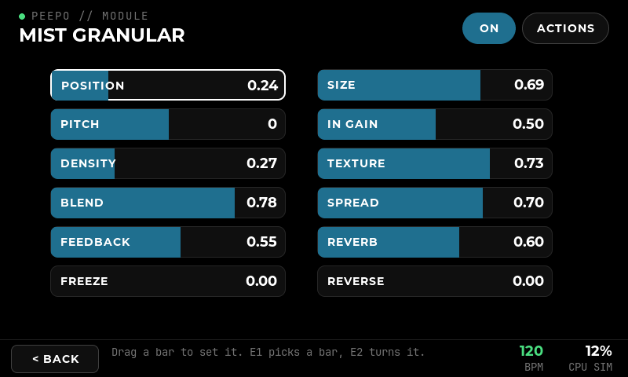
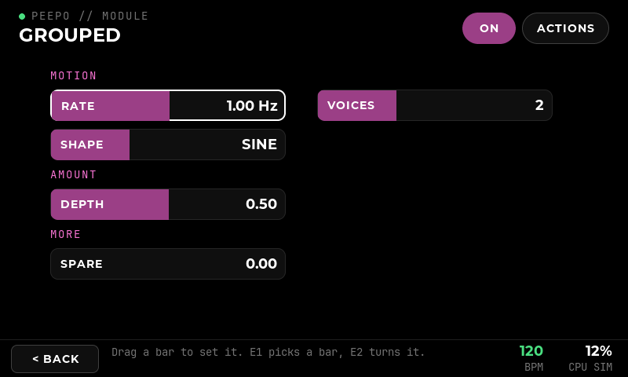

# Module page and two encoders

> Since 20 October 2026 the bars are smaller, and a rail on the left scrolls long lists: [Module rail, Aura's and Discipline's pages](40-module-rail-and-aura.md).

**Implemented:** 17 October 2026, on the Windows PC. **Scope:** the module (parameter) page redone, and the physical controls cut from four encoders to two. **Verified with:** real LVGL pointer and control checks on Windows (`peepo_ui_check`), the controls and Linux input tests, and the Linux build under WSL. **Not covered:** the physical screen and encoders; how a drag feels on the 5-inch touchscreen.

## Why

The old page showed four large tiles at a time, with sliders, switches and drop-downs, and **<** / **>** to page through the rest. A module with twelve controls took three pages, and four encoders were needed to follow the tiles. Beebo shows a dozen controls on one screen as coloured bars (`images/poly-list.png`). This follows that direction without copying it.

## The module page

- **Every control is a bar**, in two columns of six: name on the left, value on the right, filled from the left as far as the value goes, in the module's group colour. Twelve controls fit without scrolling; more scroll.
- **Drag a bar sideways** to change it. The drag is relative: the full width of the bar is the full range, so touching a bar never makes its value jump. Whole numbers move in whole steps, logarithmic controls (frequency, time) in even ratios. The engine hears the value while the finger moves.
- **Tap a switch** to flip it (ON / OFF, fully filled when on). **Tap a mode** to step to the next one; it wraps. Tapping a sliding bar only highlights it.
- **Groups** from the catalogue overlay are headings in the module's colour (for example MOTION, AMOUNT), with ungrouped controls under MORE. There are no pages.
- **A file** (a NAM model, an impulse response) is the first bar: its label and the file's name; tap it to choose.
- **A time in beats** shows its note (1/8) and, under the name, the same time in milliseconds at the module's tempo.
- **Header:** the module name, an **ON** pill in the module's colour (tap to bypass; it then reads **BYPASSED** and the bars dim), and **ACTIONS** (duplicate, delete, assign a stomp). Delete is no longer on the page itself.
- **The Tuner** keeps its meter above its bars.

The custom Clouds and Delay pages (Texture / Mix-hold tabs, Character buttons) and their **All** / **Custom** switch are gone: those demo modules show all their controls on one page anyway.

## Two encoders

| | Encoder 1 (select) | Encoder 2 (value) |
| --- | --- | --- |
| Module page | Moves the white highlight from bar to bar (scrolling it into view) | Turns the highlighted bar; push and turn for fine steps |
| Push on module page | Flips a switch, steps a mode, opens the file list; on a value, switches encoder 1 between moving and turning it | Flips a switch or steps a mode |
| Patch | Highlights a module, left to right; push opens it | Steps through the header buttons (+ Add, Patches, Settings); push presses one |
| Browser | Steps through the cards; push adds the picked one | Steps through the groups |
| Tempo | Turns the tempo; push taps it | The same |
| Other pages | Steps through the buttons; push presses the highlighted one | |
| Hold (0.7 s) | Back, wherever there is a Back | |

**One encoder is enough.** Pushing encoder 1 on a value turns its highlight the module's colour, and encoder 1 then turns that value; another push goes back to moving between bars.

**Pinning** is still possible in **Settings → Controls**: a pinned encoder turns its target on every page, a tap opens that target's page with it highlighted, and a hold unpins it. Holding an encoder no longer pins it, because the hold of encoder 1 is now Back. A patch saved with an assignment to encoder 3 or 4 keeps it, but it does nothing.

## Hardware

`config/pi/config.txt` and `config/pi/controls.conf` now enable encoder 1 (GPIO 5, 6, push 12) and encoder 2 (GPIO 13, 16, push 17) only. GPIO 22–27 are free again. The simulator keys are **Q/A** and **W/S** for the turns and **1**, **2** for the pushes; **Z, X, C** are still the stomps.

## Verification

`peepo_ui_check` (all passing, 17 October 2026):

- Drive's three bars, a drag reaching the engine while the finger moves and the bar showing the new value; a drag while the engine is disconnected changes nothing.
- Clouds' six controls on one page; tapping Freeze; dragging Density and the whole-number Pitch; a tap on a sliding bar changing nothing.
- Delay's mode stepping on each tap and wrapping, a rejected mode leaving no optimistic state, logarithmic time.
- Mist Granular's twelve controls all in view without scrolling.
- The ON / BYPASSED pill, and delete through Actions.
- Groups as headings in order; encoder 2 stepping a whole number by one and stopping at its top; a tapped mode turned back by encoder 2.
- Encoders: picking a module on the patch, groups and cards in the browser, moving the highlight and stopping at the last bar, fine turning, one-encoder turning, hold for Back, a push opening the highlighted module, a pinned encoder from the patch page, tap and hold, Settings reached with encoder 2.
- A time in beats stepped by note value with encoder 2; the file bar opening the file list; the Tuner's bar staying the same widget while the pitch changes.

`peepo_controls_tests` and the Linux `linux_input` test check the two-encoder surface and the shipped bindings (seven: two turns, two pushes, three stomps).
