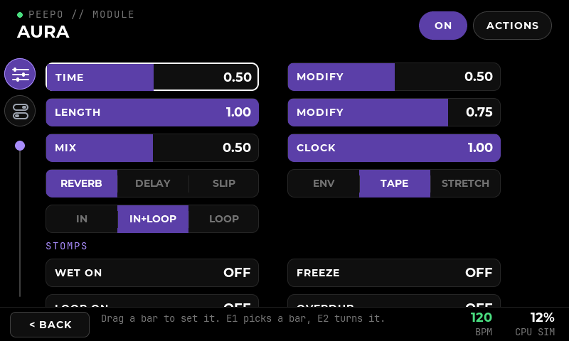
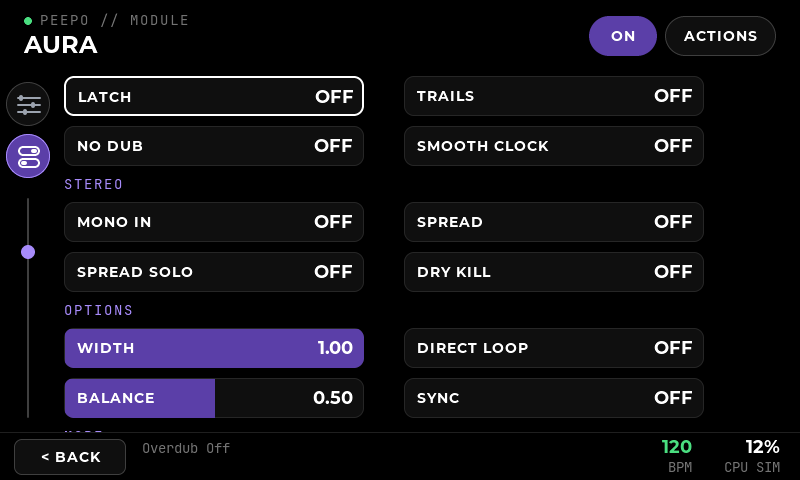
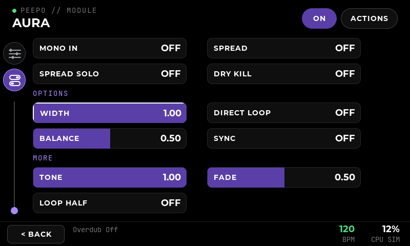
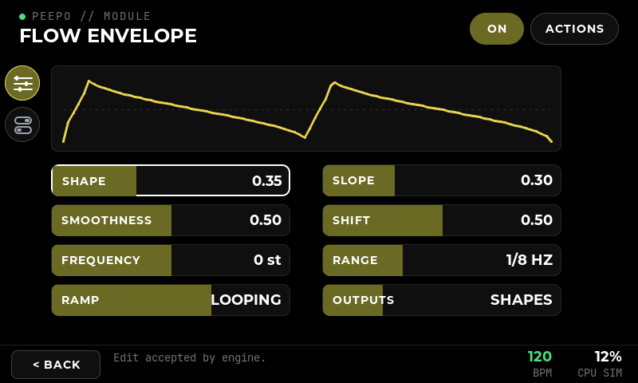

# Module rail, Aura's and Discipline's pages

**Implemented:** 20 October 2026, on the Windows PC. **Scope:** smaller bars and a scroll rail on the module page, and two-tab pages for Aura and Discipline built on them. **Verified with:** `peepo_ui_check` on Windows and under WSL (Linux build), and the full Windows `ctest`. **Not covered:** the physical touchscreen: how a swipe and a drag feel on the 5-inch panel.

## Why

The bars of [the module page](31-module-page-and-two-encoders.md) filled the whole width. A finger going up or down to scroll nearly always started on a bar, and the bar took the drag as soon as it went 8 pixels sideways. Scrolling changed values. Beebo's module pages (`images/poly-list.png`) have smaller bars, space around them, and a line with a ball down the side.

## The module page

- **Bars are smaller:** 300 by 40 instead of 372 by 48, still in two columns. The gaps between and beside them (40 between the columns, 96 on the right) belong to the list, so a swipe there always scrolls.
- **A swipe on a bar scrolls too.** A press on a bar is a value drag only if it goes more than 12 pixels sideways, at least twice as far sideways as up or down, before it goes 6 pixels up or down. Once it has gone up or down, that press is a scroll to the end, whatever it does later.
- **The rail** is left of the list: a thin line, and a ball in the module's colour where the list is scrolled to. Touch the line to jump there; drag along it to scroll. It is only there when the list is longer than the screen. It replaces the list's scrollbar.
- Tapping, encoders, groups, file bar and tuner work as before. Euclidean's and Loo-pi's own pages keep their bars as they were.

## Aura and Discipline

Aura and Discipline have a page of their own on two tabs. The two icons at the top of the rail choose: three sliders for the main controls, two on/off switches for everything else. The bars are the same compact bars as on every module, two to a row.

**Aura's main tab:**

| Left | Right |
| --- | --- |
| Time | Modify (wet) |
| Length | Modify (loop) |
| Mix | Clock |
| Reverb / Delay / Slip | Env / Tape / Stretch |
| In / In+Loop / Loop | |

Under **Stomps**: Wet on, Freeze, then Loop on, Overdub.

**Discipline's main tab:** Level, Repeats / Size, Modify / Spread, Scan / Modifier, In / Feed / Out; under **Stomps**: Loop, Scan hold, then Clear.

The three-way modes are **segmented bars**: every choice shows, the chosen one lit. Tap a choice to take it, or drag along the bar; it snaps to the choice under the finger and is sent when you let go. They have no name, only their choices. Modifier has five choices, too many to show, so it is an ordinary bar: tap to step.

**The second tab** has everything else, under the overlay's groups (Switches, Stereo, Options, Tempo and output...). A mode with up to three choices is a segmented bar here too. Discipline's two switch groups are one, **Switches**, in the overlay.

**Encoders:** encoder 1 runs through the main tab's bars and goes on to the second tab, then back the same way, so both tabs read as one list. Encoder 2 turns a segmented bar one choice at a time.

**The code:** `pedal_layout` in `src/ui/application.cpp` lists each module's main bars (in order, with a name override and whether a bar is segmented) and its stomps; `pedal_view` builds both tabs from it. A module is matched by URI when its controls match its catalogue entry, as Loo-pi's and Euclidean's are. A missing control just leaves its place empty. Another module gets a page like this by adding an entry to `pedal_layout`.

## Flow Envelope

**Added:** 27 October 2026, from an approved mockup (`images/mockup-flow-*.png`).

Flow Envelope (Tides) has the same two tabs. Its main tab has the **wave** at the top, as wide as both columns: the shape its first output plays, redrawn as Shape, Slope, Smoothness, Ramp or Range moves, while a bar is still being dragged and when MIDI or a scene changes a value. A looping wave swings about a dotted middle line, two cycles across; AD and AR rest, play once and rest again. Under it, two to a row:

| Left | Right |
| --- | --- |
| Shape | Slope |
| Smoothness | Shift |
| Frequency | Range (1/8 Hz, 2 Hz, 130 Hz) |
| Ramp (AD, Looping, AR) | Outputs (Shapes, Levels, Times, Frequencies) |

Range, Ramp and Outputs are ordinary choice bars with their names: tap to step. The second tab has the five CV amounts under **CV amount**. Beebo's page draws a curve at every point of each slider; this one draws the wave itself once.

**The wave** is worked out in `src/core/flow_wave.hpp` from Tides 2's own formulas (MIT): the wave tables of `resources/lookup_tables.py`, the skewed ramp of `ramp_shaper.h`, and the folder and filter of `poly_slope_generator.h`. Above noon, Smoothness folds the wave; below it, it filters it. It is a drawing: the CV inputs and the frequency are not in it. `PedalLayout::wave` turns the drawing on for a pedal page.

**The catalogue:** the plugin declares Range and Ramp as 0 to 3 and Mode as 0 to 4, but wraps round (Range 3 plays as 0). The overlay cuts them to 0 to 2, 0 to 2 and 0 to 3 with the new `"maximum"` key and names the choices; Mode is shown as **Outputs**. Frequency is in semitones.

## Verification

`peepo_ui_check` (passing on Windows, 20 October 2026), with Aura and Discipline fixtures of their real port lists:

- Aura's main tab: Time and Modify, Mix and Clock on the same row, 300 pixels wide; no second-tab control on it. Discipline's main tab and its Switches tab.
- Tapping DELAY chooses it; dragging across the routing bar snaps to LOOP.
- Encoder 1 past the main tab's last bar reaches the second tab, and one detent back returns.
- The second tab shows its groups and not the main controls. A vertical swipe that starts on a bar scrolls and changes nothing. **A swipe that first drifts 10 pixels sideways and then goes down still scrolls, and the bar keeps its value** (the old rule took it as a drag).
- Touching the bottom of the rail scrolls to the end; the first icon brings the main tab back.
- Every earlier check still passes with the smaller bars (drags now measure the bar's real width).
- Flow Envelope (27 October 2026), from the exported catalogue and the overlay: the eight main bars two to a row below the wave, AD then Looping set by the engine and redrawn (captures 96 and 97), and the CV amounts on the second tab (98). `peepo_core_tests` checks the wave: a triangle when centred, a one-shot that rests either side, an early peak for a low Slope, a softer wave for low Smoothness and a folded one for high, never outside its box. `peepo_catalogue_tests` checks the narrowed ranges and the new key's refusals.
