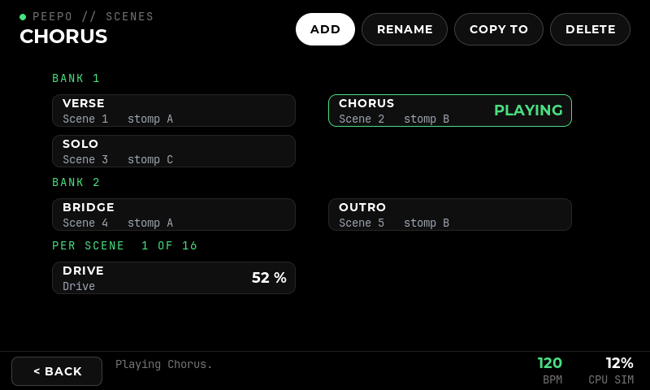
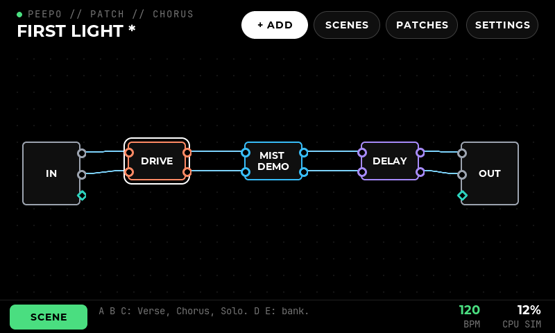

# Scenes

**Planned 24 October 2026. P13.1 (measurements), P13.2 (atomic bundles, engine patch 0012) and P13.3 (spill bypass, engine patch 0013) done in WSL the same day, P13.4 (`"bypass": "spill"` in the catalogue, 21 modules marked) and P13.5 (our own plugins: Discipline's Trails on by default, the tail check on the rest) on 25 October ([record](evidence/scenes-results.md)), P13.6 (the scene model in `src/core`) and P13.7 (the engine commands; scenes stored in the engine's graph and the patch) the same day, P13.8 (the screens, and stomp or scene mode per patch) the same day, and P13.9 (switches D and E, the stomps playing scenes, and scene select by MIDI) the same day; P13.10 measured on the Pi on 26 October ([record](evidence/scenes-results.md#on-the-pi-p1310)), and played with guitar (a USB keyboard standing in for the footswitches): no click or gap, tails ring through the next scene; and by MIDI CC from a USB keyboard. The real footswitches and a MIDI foot controller remain.** Decided with the user: a scene stores every module's bypass plus only the parameters marked "per scene"; up to **8 scenes** per patch; delays and reverbs ring on when bypassed, including Discipline's and Aura's by default. The steps are Phase 13 of the [implementation plan](10-technical-implementation-plan.md#phase-13--scenes).

A scene is a saved state inside one patch. "Verse" can have the chorus on and the drive off, and "Solo" the reverse, so one song is played on one patch by changing scenes. Changing scene must not break the sound: no gap, no click, and the echoes and reverb of what was just switched off ring on.

## Why scenes, not patch changes

Loading a patch replaces the engine's blocks with new ones ([Ingen adapter](15-ingen-adapter.md)). Every sound stops, tails included, and there is a gap that has never been measured; [validation](06-validation.md) says not to promise seamless patch changes. Making patch changes seamless would need two graphs running at once and a crossfade between them, which is not planned.

A scene never adds or removes a module. It only sets values and bypass switches on modules that are already running, exactly like a stomp press, which already plays without a gap. So a scene is "many stomp presses at once, saved with the patch". The price: every module used in any scene is in the graph all the time, so **a patch must fit the Pi's CPU with all its modules on**.

## Tails today (measured 24 October 2026)

There are two kinds of bypass ([catalogue export](16-catalogue-export.md)):

**The engine's bypass**, used by every module without `"bypass": "port"` in the overlay: Stereo delay, Dub delay, Tempo delay, Bitcrushed delay, the IR reverbs, Mist, Gx, Dragonfly and the rest. Ingen's `BlockImpl::bypass` is a "dumb bypass": it stops calling the plugin and copies each input to the matching output, and clears an output with no matching input. Three faults for a delay or reverb:

1. **The tail stops dead.** Measured in WSL on all 24 such Delay, Reverb and Texture modules installed there: every one with a tail at its defaults (14) lost it at once.
2. **It clicks.** There is no ramp: 23 of 24 clicked when bypassed with a tone playing, 42 to 74 dB above the tone's own variation.
3. **The plugin's memory freezes.** Its buffer is not cleared, so when it is switched back on the echoes left from before play again: 19 of 24, up to -2 dBFS, where the same module never bypassed had decayed to silence.
4. **Mono in, stereo out loses a side.** A mono-to-stereo module bypassed plays the dry signal on the left only (from the code; the only such module, IR Reverb - Mono to Stereo, is not in WSL and is measured on the Pi).

**The plugin's own switch** (`"bypass": "port"`), used by our own plugins. What each does when switched off, read from their source and measured: none replays, and clicks stay at 5 to 15 dB, the tone's own variation (Eureka Prism measured 23 dB while almost silent at its defaults; to be heard on the Pi).

| Module | When switched off | Tails |
| --- | --- | --- |
| Eureka (all 12) | Input fades out; every effect passes `spill=true`, so the wet sound stays at full level (`eureka/src/dsp/wrapper.hpp`) | Ring on (measured: Skip, Spool, Hush, Slowmo, Granny) |
| Euclidelay | Input fades out of the loops; the voices keep repeating (`src/engine.cpp`) | Ring on (measured) |
| Drizzle | Input to the grains fades out; the wet sound is not faded (`src/drizzle.cpp`) | Ring on (measured) |
| Aura | Wet sound kept while **Trails** is on, default 1 (`aura.ttl`) | Ring on by default (measured) |
| Discipline | Echoes dropped unless **Trails** is on, default 1 from 0.4.1 (`discipline.ttl`; 0 before) | Ring on by default (measured); cut with Trails off |
| Loo-pi | Each loop mutes with a short ramp (`lv2/stereo_loop.cpp`) | A looper, not a tail: kept as it is |

## Making every delay and reverb ring on

### Spill bypass in the engine

For the third-party modules, a new bypass in Ingen: the block keeps running, its inputs are replaced by silence, and its outputs are added to the dry signal:

```
bypassed output = input + plugin(silence)
```

With a silent input the plugin's own dry path gives nothing, so what comes out is only the tail, whatever the module's mix is set to. The buffer then drains naturally, which also removes fault 3; the ramps below remove fault 2. Details:

- **Ramps.** Switching off fades the plugin's input to silence over about 5 ms; switching on fades it back, and crossfades the output from `input + plugin` to `plugin` over the same time. Without the input fade, a hard cut is itself a click that the delay repeats.
- **Mono to stereo.** An output with no matching input takes the dry signal from the last input, so a mono-to-stereo module bypassed plays the dry signal on both sides (fault 4). The same fix applies to the dumb bypass.
- **Stopping when silent.** Once every output has stayed below -90 dBFS for one second, the block falls back to the dumb bypass and stops using CPU. Its buffer is silent by then, so switching it on again brings nothing back.
- **Allocation.** The silent input buffers and the ramp state are made when the block is created, never in the audio thread.
- **Marking.** A new overlay value, `"bypass": "spill"`, for Delay and Reverb modules (and any Texture module with a long memory) after each passes the tail check. The adapter sets it on the block as the property `peepo:spillBypass true` (`urn:peepo:ns#spillBypass`, Bool or Int) when the module is added or a snapshot rebuilt, as it does for the block's output level (engine patch 0008), so it is saved with the patch; a stored patch from before its module was marked gets the mark as it loads. The rule is refused for a module that already uses `"bypass": "port"`, and for one with no audio output. *Done 25 October 2026 (P13.4, [record](evidence/scenes-results.md#spill-bypass-in-the-catalogue-p134)):* 21 modules marked, 14 delays, 6 reverbs and Mist. Not for a module that makes sound from silence: **Mist Spectral** sustains itself and would keep sounding when bypassed, and **Vinyl** never stopped costing CPU.
- **Written as** engine patch 0013 (`0013-spill-bypass.patch`), in `BlockImpl` and `LV2Block`. Also: the output level (0008) applies to the tail, not to the dry signal; a block already in the dumb bypass when it is marked stays there until switched on, so a frozen buffer never spills out; a duplicated block keeps the mark; unmarked blocks bypass as before.
- **Measured in WSL** (`27-scenes.sh spill`, [record](evidence/scenes-results.md#spill-bypass-engine-patch-0013-p133)): every module with a tail rings on, within 0.4 dB of the module left on; no click above 20 dB switching off and on (largest 19.2, was up to 74); none replays; Euclidelay, the one module with one input and two outputs in WSL, keeps both sides under either bypass; the heavier reverbs fall back to the empty engine's CPU after their tail.

### Our own plugins

- **Discipline:** Trails defaults to 1 (0.4.1). Patches saved with Trails at 0 keep it, so their sound does not change: Ingen saves every control's value, and a patch saved by 0.4.0 loads with Trails 0 (measured).
- **Aura, Eureka, Euclidelay, Drizzle:** already ring on; each gets the tail check below so it stays that way.
- **Loo-pi:** unchanged. Bypassing a looper mutes its loops, and a scene that does not change Loo-pi's bypass leaves its loops playing.

*Done 25 October 2026 (P13.5, [record](evidence/scenes-results.md#our-own-plugins-p135)):* `tools/ingen-spike/28-own-tails.sh` builds our plugins at their pins and runs the tail check on them. Every one with a tail rings on, Discipline included, and none replays. Switching off and on again, Aura clicks around 20 dB and Eureka Prism 29 dB while almost silent: for the ear on the Pi (P13.10). Larger clicks now and then (66 to 68 dB) were xruns of WSL's dummy backend, lost cycles in the recording; the check now measures again after an xrun. The module list marks our own modules that ring on. Discipline pinned at 12625b6 in `14-more-plugins.sh` and `reference/manifest.json`.

## What a scene stores

- **Every module's bypass, always.** A module added to a patch that has scenes is written into every scene with its bypass at the time; one removed leaves every scene.
- **Only the parameters marked "per scene".** The patch holds one list of marked parameters, the same for every scene, at most 16. Marking a parameter copies its current value into every scene; unmarking keeps the current value for all of them. Every other parameter is shared: adjusting the amp's tone in Verse changes it in every scene, which is almost always what the player means.
- **A name**, up to 12 characters, default "Scene 1" to "Scene 8".
- **Not stored per scene:** tempo, routing, cables, modules, assignments, the CC list sent on load, file choices (models, IRs, samples). These stay patch-wide.

A patch with no scenes behaves as today. Adding a scene copies the current state into it, places it last and makes it current; scenes are added up to 8 and can be renamed, copied over another, reordered and deleted. The current scene cannot be deleted while others exist; deleting the only one returns the patch to no scenes, its marked parameters unmarked. A new scene takes the lowest default name no other scene has.

### Storage

Graph properties, like the stomp assignments ([physical controls](18-physical-controls.md)): they live in the engine, are saved in the bundle, and are found again by an interface that restarts. Entries are separated by spaces, fields by `|`; plugin URIs hold neither.

```
peepo:scene-count   3
peepo:scene-current 2
peepo:scene-mode    1
peepo:scene-params  "m4|<plugin>|gain m7|<plugin>|mix"
peepo:scene-1-name  "Verse"
peepo:scene-1       "b|m3|<plugin>|0 b|m4|<plugin>|1 p|m4|<plugin>|gain|0.42 p|m7|<plugin>|mix|0.3"
peepo:scene-2-name  "Solo"
peepo:scene-2       "b|m3|<plugin>|1 b|m4|<plugin>|0 p|m4|<plugin>|gain|0.8 p|m7|<plugin>|mix|0.5"
```

`b` entries hold 1 when bypassed. As with assignments, each entry keeps its module's plugin, so a different module that later holds the same identity is never changed by mistake; an entry whose module is gone or holds another plugin is kept as an orphan, which validation accepts and nothing applies. Duplicating a module copies its scene entries to the copy. The interface's session snapshot (Save snapshot / Load) includes the scene properties.

*The model (P13.6, 25 October 2026):* `Graph::scenes` in `src/core/model.hpp`. `encode_scenes` and `decode_scenes` give the properties above and read them back; reading never fails: a malformed entry is dropped, as is a parameter entry for a parameter not marked, a count over 8 is cut, a bad name gets the default and the current scene is kept in range. An orphan keeps the block symbol it was read with, so it is written back unchanged. Duplicating a module marks the copy's parameters only when all of them fit in the 16; its bypass follows the original's in every scene either way. Tested in `peepo_core_tests`.

Loading a patch restores the scene that was current when it was saved: the saved block values already are that scene, so nothing extra is sent.

## Changing scene

- **One message group.** Peepo works out what differs between the live state and the target scene (bypasses and marked parameters only) and sends it between BundleStart and BundleEnd. Ingen executes a bundle in one audio cycle only when started with `--atomic-bundles` (`-a`, default off; `Mark::get_execution`), and even then each change kept the frame it arrived at, so parameter changes in one bundle landed up to 17 frames apart. **Engine patch 0012** (`0012-atomic-bundle-one-frame.patch`) puts every event of an atomic bundle on the cycle's first frame. The `peepo-engine` launcher, `tools/ingen-spike/env.sh` and `tools/pi/check-engine.sh` start the engine with `-a`. Measured in WSL: with both, 120 of 120 bundles (bypasses, parameters, and the two mixed) changed on one frame; without, mixed bundles were up to 138 frames apart. The adapter, patch storage and MIDI checks pass unchanged with `-a` ([record](evidence/scenes-results.md)).
- **One command for every client.** A new engine command `SelectScene{n}`: `IngenEngine` sends the group and sets `peepo:scene-current` in it; the simulator applies the same changes at once. The difference is worked out by a pure function in `src/core`, unit tested, so the interface and `peepo-midi` (already an engine client, independent of the interface) behave the same.
- **Parameter jumps** rely on each plugin smoothing its own controls, as for a knob turned fast. Most do; the scene check below finds any that click, and their overlay gets a note, or Peepo ramps those few itself.
- **Selecting the current scene again** restores its saved state (see "Edits" below).
- **Playing, not editing.** Selecting a scene leaves the unsaved marker alone, like a tempo followed from MIDI clock: the scenes are unchanged, and the values sent are a scene's. Saving afterwards stores the scene then current.

*Built 25 October 2026 (P13.7, [record](evidence/scenes-results.md#scenes-sent-and-stored-p137)):* the commands `SelectScene`, `AddScene`, `RenameScene`, `CopyScene`, `MoveScene`, `DeleteScene` and `MarkSceneParameter` in `src/engine/engine.hpp`, applied by `IngenEngine` and the simulator. A selection is one bundle: `ingen:BundleStart`, the bypasses and values `scene_changes` gives, `peepo:scene-current`, `ingen:BundleEnd`; with nothing to change and the scene already current, nothing is sent. `SetBypass` and `SetParameter` take `scene` for an edit on the touch screen, which writes the current scene in the same group; stomps, knobs and MIDI leave it false. Every scene edit, and a module added, duplicated or removed in a patch with scenes, sends only the scene properties that changed and empties the slots no longer used; a new patch and a load empty them first. Checked against the real engine in WSL, through its own save and load and with a second client.

## Edits

- **On the touch screen, the current scene is edited.** A bypass changed, or a marked parameter set, is written into the current scene in the same message group, and the patch is dirty as for any edit. An unmarked parameter is a patch-wide edit, as today.
- **Stomps, knobs, MIDI CC and learned controls are performance changes:** they change the sound but not the stored scene. Selecting the scene again, or another and back, brings back its saved state. (Helix calls this "discard"; it lets a player kick a boost on for one bar without rewriting the scene.)
- On the module page, a marked parameter's bar says **Per scene** under its name; holding a bar opens its page, where **Same in every scene** / **Per scene** is chosen.

## On the screen, stomps and MIDI

Built to the [design language](03-interface-and-controls.md) from a mockup approved on 25 October 2026 (`docs/images/mockup-scenes-*.png`). Decided with the user: **no new row on the patch page**; the screen is small, and the footer had room.

- **Stomp mode and scene mode, per patch.** In **stomp mode** the switches act as the player assigned them, as before scenes. In **scene mode** they select scenes. The mode is saved with the patch (`peepo:scene-mode`, 1 in scene mode) and is changed only on the screen: the pill at the bottom left of the patch page, where Back is on other pages, reads **STOMP** (outlined) or **SCENE** (green), and a tap changes it. A patch without scenes stays in stomp mode; scene mode is refused until a scene exists, and deleting the last scene returns to stomp mode. In scene mode the patch page names the scene playing in its top line (`PEEPO // PATCH // CHORUS`) and hides the stomp badges on the modules.
- **Five switches, as on Beebo:** A, B and C are the three stomps; **D is A+B** pressed together and **E is B+C**. In stomp mode all five can be assigned. In scene mode A, B and C select the three scenes of the current **bank** (scenes 1-3, 4-6, 7-8), D steps to the previous bank and E to the next. Telling D and E from a single stomp: a single stomp acts about 40 ms after it is pressed, unless its neighbour joins it. Built in P13.9.
- **Scenes page**, from the **SCENES** pill on the patch page's header: header pills **Add** (white), **Rename**, **Copy to**, **Delete**, and the current scene as the title. The scenes are listed by bank as bars, each with its number and the stomp that plays it in scene mode; the one playing is outlined and says PLAYING; a tap plays a scene. Below, **Per scene N of 16** lists the marked parameters with their module and value; a tap opens the module. **Copy to** and **Delete** ask for a scene with the next tap (Cancel in the header); Delete asks first, and the scene playing cannot be picked while others exist. Rename uses the name keyboard, 12 characters.
- **Module page:** the top line names the scene that edits go into (`PEEPO // MODULE // VERSE`); a marked parameter says **Per scene** under its name. Edits made by touch, and by the encoders moving through the page, are written into the current scene; a pinned encoder, a stomp, MIDI and learned controls are performance changes.
- **Holding a bar** opens the parameter's page (`PEEPO // PARAMETER`): MIDI learn as before and, in a patch with scenes, **Same in every scene | Per scene** across both columns, lit in the module's colour.
- **MIDI:** a CC selects a scene (value 0 to 7 is scene 1 to 8), on the program-change channel set in Settings → MIDI. The CC number is a setting, default 69 (Line 6's choice, so foot controllers already set up for it work). Program change still selects a patch.
- **Later:** a scene may also send a few CC messages to the player's other gear, like the patch's CC list on load, so an external pedal changes with the scene.

*Built 25 October 2026 (P13.8):* the screens above, `SetSceneMode` in `src/engine/engine.hpp` with `set_scene_mode` in `src/core`, stored by `IngenEngine`, the simulator and the bundle. `peepo_ui_check` captures 88-94 (empty Scenes page, the held bar's page, the marker, the Scenes page, Copy to, the patch in scene and stomp mode). Not yet: the stomps selecting scenes, D and E, and the stomp letters on the screen (still 1-3), which are P13.9.

*Built 25 October 2026 (P13.9, [record](evidence/scenes-results.md#stomps-and-midi-p139)):*

- **D and E.** `ControlRecognizer` (`src/controls`) holds each stomp's press for 40 ms (`chord_ms`). If its neighbour is pressed in that time, the two are one switch: A+B is `stomp4` (D), B+C is `stomp5` (E). The first of the two released ends it; the other's release does nothing. A stomp released inside its 40 ms plays its press and release at once. A and C pressed together are two stomps. D and E are assigned like any stomp, on Settings → Controls or by holding a module and pressing both, and saved as `peepo:control-stomp4` and `-stomp5`.
- **Letters.** The screen names the stomps A to E everywhere: Settings → Controls, the badges on the patch and on Loo-pi's commands, the module's actions and the messages. The Foot switch module's Stomp control reads A, B or C. Its plugin only counts to three, so it cannot listen to D or E.
- **Scene mode.** A, B and C play the three scenes of the bank shown. D steps to the previous bank and E to the next, wrapping round. The footer names the bank and its scenes (`Bank 2. A: Bridge. D E: bank.`). The bank shown is the playing scene's until D or E moves it, and is forgotten once another scene plays. A place with no scene says so. Footswitch modules and assignments do nothing in scene mode, but a Loo-pi command already held still lets go when its stomp is released. A scene played by a stomp is a performance change, like a tap on the Scenes page: the patch is not marked edited.
- **MIDI.** `peepo-midi` reads a control change on the program-change channel (`scene_change` in `src/midi/clock.hpp`). Values 0 to 7 play scenes 1 to 8, and a value for a scene the patch does not have does nothing. The controller is `scene_cc` in the MIDI settings file, default 69, set on Settings → MIDI (**Plays scene**, under program change). With program change off, the scene CC is off too. A scene that arrives with a program change waits until that patch has loaded, so a foot controller can send both.

 

## Checks

- **Tail check** (`tools/ingen-spike/27-scenes.sh tails`, root, in WSL; `SCENES_LV2` adds bundle directories, `SCENES_ON_AGAIN=1` measures the click switching off and on; `28-own-tails.sh` runs it on our own plugins at their pins): for each Delay, Reverb and Texture module, the tail, click, replay and side checks described in the [record](evidence/scenes-results.md). Pass: the tail within 3 dB of the module left on, a click no more than 20 dB above the tone's own variation, no replay, no lost side. The engine's bypass fails all of them, which shows the check works. `27-scenes.sh spill` runs the same with the engine's bypass spilling, the click switching off and on again, and the CPU after the tail.
- **Atomic change** (`27-scenes.sh atomic`): two modules switched opposite ways in one bundle, by bypass, by parameter and mixed; both outputs must change on the same frame. Run with and without `-a`.
- **Scene changes while playing** (`27-scenes.sh playing`): 8 scenes, 4 modules each changing, switched every 500 ms for a minute: no xrun, no dropout, every change read back. `SCENES_EVERY=0` plays the same minute without changes: the probe's own xruns, to compare against.
- **CPU:** the heaviest catalogue patch with all modules on; spill-bypassed delays stop costing CPU after their tail.
- **Storage:** `peepo_core_tests` (differences, edits, orphans, duplicate, remove), `peepo_storage_tests` (bundle round trip), `peepo_ingen_tests` (a second client sees a scene change); `peepo_ui_check` screens for the mode pill, the Scenes page, the marker and the held bar's page.
- **On the Pi** (`tools/pi/check-scenes.sh tails|spill|playing|cpu`, root, with `27-scenes.py` and `ingenprobe.py` beside it): the tail check, the spill check before marking a module, scenes while playing and the CPU of every stored patch, with the Pi's own build and audio interface. The first three stop the instrument and run an engine of their own; the IR Reverbs get a made-up impulse response. The instrument comes back at the end. [Record](evidence/scenes-results.md#on-the-pi-p1310).
- **On the Pi**, by ear, with guitar: a verse/solo patch with a delay and a reverb switched by stomps and by a MIDI foot controller.
